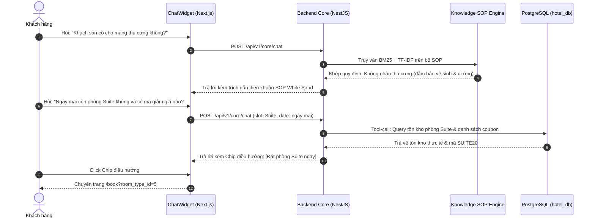
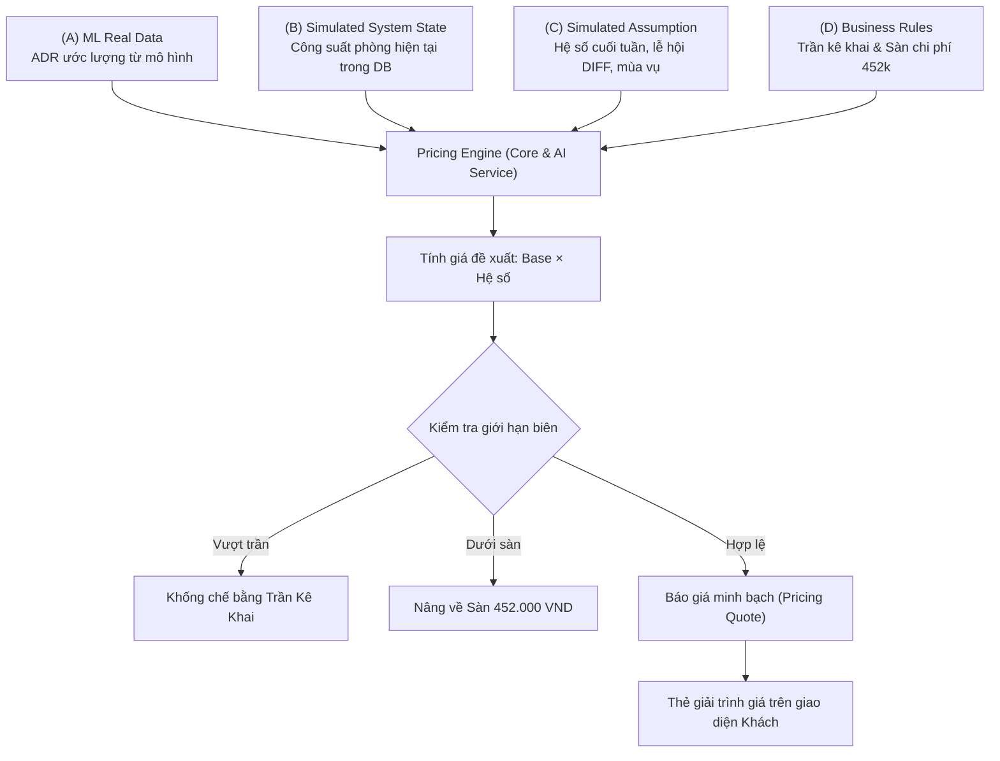
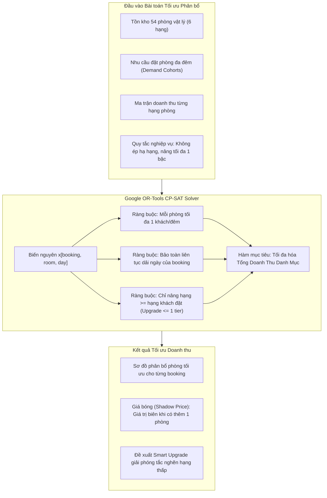
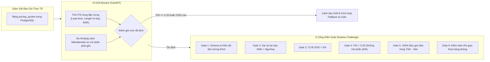

# HƯỚNG DẪN DEMO, KIỂM THỬ VÀ BẢO VỆ ĐỒ ÁN HOTELAI
## Hệ Thống AI Hỗ Trợ Định Giá Động & Quản Trị Phân Bổ Phòng Khách Sạn

> **Dành cho:** Sinh viên / Tác giả đồ án dùng để tự kiểm thử hệ thống, quay video demo, xây dựng slide báo cáo và bảo vệ trước Hội đồng chấm Đồ án tốt nghiệp / Môn học Trí tuệ Nhân tạo.  
> **Khách sạn mô phỏng:** **White Sand Boutique Hotel Đà Nẵng** (89-91 Võ Văn Kiệt, Sơn Trà, TP. Đà Nẵng — 15 tầng, 6 hạng phòng, 54 phòng vật lý).  
> **Cổng truy cập duy nhất:** `http://localhost` (Nginx Gateway hợp nhất).

---

## MỤC LỤC
1. [Tổng Quan Kiến Trúc & Chuẩn Bị Môi Trường](#1-tổng-quan-kiến-trúc--chuẩn-bị-môi-trường)
2. [Bảng Tài Khoản & Dữ Liệu Nền Khách Sạn](#2-bảng-tài-khoản--dữ-liệu-nền-khách-sạn)
3. [Kịch Bản 1 — Trải Nghiệm Khách Hàng & Trợ Lý Hội Thoại AI](#3-kịch-bản-1--trải-nghiệm-khách-hàng--trợ-lý-hội-thoại-ai)
4. [Kịch Bản 2 — Quy Trình Đặt Phòng, Định Giá Động Minh Bạch 4 Nguồn & Bảo Vệ Giá Sàn](#4-kịch-bản-2--quy-trình-đặt-phòng-định-giá-động-minh-bạch-4-nguồn--bảo-vệ-giá-sàn)
5. [Kịch Bản 3 — Quản Trị Doanh Thu, Tối Ưu Phân Bổ Phòng Google OR-Tools CP-SAT & Vận Hành](#5-kịch-bản-3--quản-trị-doanh-thu-tối-ưu-phân-bổ-phòng-google-or-tools-cp-sat--vận-hành)
6. [Kịch Bản 4 — Quản Trị An Toàn AI, Giám Sát Lệch Phân Phối (Drift) & Bandit Lab](#6-kịch-bản-4--quản-trị-an-toàn-ai-giám-sát-lệch-phân-phối-drift--bandit-lab)
7. [Kịch Bản 5 — Nền Tảng Học Máy Học Thuật & Phòng Thí Nghiệm Đối Chứng](#7-kịch-bản-5--nền-tảng-học-máy-học-thuật--phòng-thí-nghiệm-đối-chứng)
8. [Bộ Câu Hỏi & Đối Đáp Phản Biện Trước Hội Đồng (Defense FAQ)](#8-bộ-câu-hỏi--đối-đáp-phản-biện-trước-hội-đồng-defense-faq)

---

## 1. TỔNG QUAN KIẾN TRÚC & CHUẨN BỊ MÔI TRƯỜNG

### 1.1. Kiến Trúc 4 Lớp Thống Nhất
Hệ thống được thiết kế theo chuẩn phân tách trách nhiệm cao (Separation of Concerns):
- **Lớp 1: Giao diện (Presentation Layer) — `4_frontend_nextjs`**: Next.js 14 App Router, Tailwind CSS, SSR + CSR tối ưu, hỗ trợ cả giao diện khách hàng (Public/Guest) và bảng điều hành chuyên sâu (Admin Operations).
- **Lớp 2: Điều phối nghiệp vụ (Core Orchestrator) — `3_backend_core`**: NestJS, kiến trúc module hóa, xác thực bảo mật JWT qua HttpOnly cookie, quản lý giao dịch database ACID, advisory locking chống overbooking, và transactional outbox.
- **Lớp 3: Trí tuệ nhân tạo & Tối ưu (AI & Optimization Service) — `2_ai_pricing_service`**: FastAPI, scikit-learn (Random Forest, HistGradientBoosting, Logistic Regression), Split Conformal Prediction (khoảng tin cậy 90%), Saabas Tree Interpreter, PSI Drift Monitor, Thompson Sampling Bandit và Google OR-Tools CP-SAT solver.
- **Lớp 4: Dữ liệu & Cổng truy cập (Infrastructure) — `1_database_infra` & `5_nginx`**: PostgreSQL (chứa schema quan hệ, lịch sử snapshot báo giá, audit log), Redis (cache catalog), Kafka (hàng đợi domain events) và Nginx (Reverse Proxy & Rate Limiter thống nhất tại cổng 80).

### 1.2. Kiểm Tra Trạng Thái Hoạt Động (Health Checks)
Trước khi demo hoặc trình chiếu, mở trình duyệt hoặc tab ẩn danh truy cập các đường dẫn sau để đảm bảo 100% dịch vụ đã sẵn sàng:
- **Toàn hệ thống Nginx:** `http://localhost` (Giao diện trang chủ White Sand Boutique Hotel).
- **Backend Readiness:** `http://localhost/api/v1/core/health/ready` (Kiểm tra PostgreSQL, Redis, Outbox sẵn sàng `status: "ok"`).
- **AI Service Readiness:** `http://localhost/api/v1/ai/health` (Kiểm tra model AI pricing, OOD detector sẵn sàng `status: "ok"`).

---

## 2. BẢNG TÀI KHOẢN & DỮ LIỆU NỀN KHÁCH SẠN

### 2.1. Tài Khoản Sử Dụng Demo
| Vai trò | Email đăng nhập | Mật khẩu | Phạm vi quyền hạn |
| :--- | :--- | :--- | :--- |
| **Quản trị viên (Admin)** | `admin@test.com` | `Admin@123` | Toàn quyền Dashboard, Tape Chart, Booking, Tối ưu OR-Tools, Giám sát AI Drift & Cấu hình giá |
| **Khách hàng có sẵn (Guest)** | `user@test.com` | `User@123` | Xem phòng, đặt phòng, áp coupon, xem lịch sử đặt phòng & hủy phòng |
| **Khách hàng đăng ký mới** | Tùy chọn tại `/register` | Tự đặt (>= 8 ký tự, chữ hoa, số) | Trải nghiệm luồng đăng ký mới của khách vãng lai |

### 2.2. Danh Mục 6 Hạng Phòng & 54 Phòng Vật Lý (White Sand Đà Nẵng)
| Mã | Tên hạng phòng | Giá cơ sở | Trần kê khai | Sức chứa | Vị trí phòng (Tầng) |
| :---: | :--- | :---: | :---: | :---: | :--- |
| **1** | Superior Room | 1,200,000 VND | 1,550,000 VND | 2 người | Tầng 3–4 (12 phòng: `301–406`) |
| **2** | Deluxe Room | 1,400,000 VND | 1,700,000 VND | 2 người | Tầng 5–6 (12 phòng: `501–606`) |
| **3** | Premium Room | 1,600,000 VND | 1,850,000 VND | 4 người | Tầng 7–8 (8 phòng: `701–804`) |
| **4** | Executive Room | 1,700,000 VND | 2,000,000 VND | 2 người | Tầng 9–10 (8 phòng: `901–1004`) |
| **5** | Suite | 1,800,000 VND | 2,150,000 VND | 3 người | Tầng 11–12 (8 phòng: `1101–1204`) |
| **6** | Studio Apartment | 2,000,000 VND | 2,300,000 VND | 4 người | Tầng 13 (6 phòng: `1301–1306`) |

*Ghi chú tầng tiện ích:* Tầng 1: Sảnh & Lễ tân; Tầng 2: Hồ bơi vô cực & Gym; Tầng 14: Nhà hàng ẩm thực Á - Âu; Tầng 15: Spa trị liệu.

### 2.3. Danh Mục 5 Mã Khuyến Mãi (Coupons Trong CSDL)
- `WHITESAND10`: Giảm 10% (tối đa 300.000 VND/đêm), áp dụng cho mọi hạng phòng (`min_room_type_id = 1`), trạng thái: **Khả dụng**.
- `SUMMER15`: Giảm 15% (tối đa 450.000 VND/đêm), áp dụng cho mọi hạng phòng, trạng thái: **Khả dụng**.
- `DIFF2026`: Giảm 12% (tối đa 400.000 VND/đêm), áp dụng dịp Lễ hội pháo hoa quốc tế Đà Nẵng, trạng thái: **Khả dụng**.
- `SUITE20`: Giảm 20% (tối đa 600.000 VND/đêm), **chỉ áp dụng cho hạng Suite & Studio Apartment** (`min_room_type_id = 5`), trạng thái: **Khả dụng**.
- `EXPIRED50`: Giảm 50%, hết hạn `2025-12-31`, trạng thái: **Vô hiệu hóa (Dùng để kiểm thử từ chối mã không hợp lệ)**.
- **Quy tắc giá sàn tuyệt đối:** Dù áp mã giảm giá cao đến đâu, giá thanh toán mỗi đêm không bao giờ được phép thấp hơn giá sàn bảo vệ biên đóng góp: `MIN_CONTRIBUTION_FLOOR_VND = 452,000 VND/đêm`.

---

## 3. KỊCH BẢN 1 — TRẢI NGHIỆM KHÁCH HÀNG & TRỢ LÝ HỘI THOẠI AI

### Mục tiêu chứng minh
Trợ lý AI (`ChatWidget`) hoạt động với cơ chế **RAG kết hợp (BM25 + TF-IDF)** dựa trên tài liệu Quy trình nghiệp vụ chuẩn (SOP) của White Sand Boutique Hotel, có khả năng **gọi công cụ (Tool-calling)** truy vấn trực tiếp CSDL PostgreSQL để kiểm tra phòng trống thực tế và điều kiện coupon, tuyệt đối **không ảo giác (Anti-hallucination)** và cung cấp Deep-link dẫn khách đến trang đặt phòng.

### Các bước thao tác trên Web:
1. **Truy cập:** Mở trình duyệt vào `http://localhost`.
2. **Khám phá trang chủ:**
   - Quan sát thông tin định danh: Khách sạn White Sand Boutique Hotel Đà Nẵng, địa chỉ `89-91 Võ Văn Kiệt`.
   - Bấm vào menu **Phòng nghỉ (`/rooms`)**: Xem lưới 6 hạng phòng với hình ảnh thực tế, tiện ích chuẩn, giá tham chiếu.
   - Bấm xem chi tiết một phòng (ví dụ: **Suite**): Đọc thông tin diện tích, tiện nghi tầng 11–12, kiểm tra ảnh tải hoàn chỉnh.
3. **Mở Trợ lý AI (Góc dưới bên phải màn hình):**
   - Bấm vào biểu tượng bong bóng chat để kích hoạt `ChatWidget`.
4. **Thực hiện 3 phép thử kiểm định năng lực AI:**
   - **Thử nghiệm 1 (Truy vấn quy định SOP & Chống ảo giác):**
     - Gõ câu hỏi: *"Khách sạn có cho mang thú cưng không và hồ bơi nằm ở tầng mấy?"*
     - *Quan sát kết quả:* AI phản hồi chính xác dựa trên tài liệu SOP: Khách sạn **không cho phép mang thú cưng** nhằm đảm bảo vệ sinh và an toàn dị ứng cho toàn bộ khách lưu trú; hồ bơi vô cực và phòng gym nằm tại **tầng 2**.
   - **Thử nghiệm 2 (Tool-calling tra cứu tồn kho CSDL theo thời gian thực):**
     - Gõ câu hỏi: *"Hôm nay còn phòng Deluxe không?"*
     - *Quan sát kết quả:* AI gọi hàm backend nội bộ, truy vấn bảng `rooms` trong PostgreSQL và thông báo số lượng phòng Deluxe đang ở trạng thái sẵn sàng đón khách.
   - **Thử nghiệm 3 (Tư vấn khuyến mãi & Deep-link chuyển đổi):**
     - Gõ câu hỏi: *"Có mã giảm giá nào cho phòng Suite không?"*
     - *Quan sát kết quả:* AI tư vấn mã `SUITE20` (giảm 20%, tối đa 600.000 VND) và hiển thị thẻ hành động kèm nút bấm **[Đặt ngay phòng Suite]**. Bấm vào nút này, trình duyệt lập tức điều hướng sang trang `/book` với hạng phòng Suite đã được chọn sẵn.

---

## 4. KỊCH BẢN 2 — QUY TRÌNH ĐẶT PHÒNG, ĐỊNH GIÁ ĐỘNG MINH BẠCH 4 NGUỒN & BẢO VỆ GIÁ SÀN

### Mục tiêu chứng minh
- Định giá động không phải là một "hộp đen" bí ẩn hay ngẫu nhiên mà được phân tách minh bạch thành **4 nguồn dữ liệu cấu thành: (A) Học máy từ dữ liệu thực, (B) Trạng thái vận hành CSDL, (C) Giả định thị trường mùa vụ, (D) Quy tắc nghiệp vụ & Giá trần/sàn**.
- Ứng dụng **Split Conformal Prediction (khoảng tin cậy 90%)** và **Saabas Tree Interpreter** để diễn giải căn cứ thay đổi giá.
- Kiểm soát rủi ro tài chính: Bất kể khuyến mãi hay giảm giá kích cầu, giá cuối cùng **không bao giờ xuyên thủng giá sàn 452.000 VND/đêm**.
- Bảo vệ giao dịch: Cơ chế **Advisory Lock + Transaction** chống overbooking khi nhiều khách cùng đặt một phòng.

### Các bước thao tác trên Web:
1. **Truy cập trang Đặt phòng:** Bấm menu **Đặt phòng (`/book`)**.
2. **Chọn thông số đặt phòng:**
   - Hạng phòng: Chọn **Deluxe Room** (Giá gốc 1.400.000 VND/đêm).
   - Ngày nhận phòng: Chọn ngày mai; Ngày trả phòng: Chọn cách 2 đêm.
   - Số khách: 2 người lớn.
3. **Quan sát Báo giá động & Thẻ giải trình minh bạch:**
   - Hệ thống tự động gửi yêu cầu báo giá `POST /api/v1/core/pricing/quote`.
   - Ngay trên màn hình xuất hiện thẻ **Minh bạch cơ cấu định giá (Guest Price Explanation Card)**:
     - **Nguồn (A) - ML Lịch sử:** Ước lượng mức giá tham chiếu thị trường.
     - **Nguồn (B) - Trạng thái hệ thống:** Tỷ lệ lấp đầy hiện tại của khách sạn (ví dụ: công suất 65% áp dụng hệ số phụ thu tương ứng).
     - **Nguồn (C) - Giả định mùa vụ & cuối tuần:** Hiển thị rõ nếu ngày đặt rơi vào thứ Sáu/thứ Bảy (+10%) hoặc mùa cao điểm du lịch biển Đà Nẵng.
     - **Nguồn (D) - Khoảng tin cậy Conformal 90%:** Cung cấp dải giá an toàn `[Giá thấp nhất, Giá cao nhất]` bảo đảm 90% độ tin cậy thống kê.
4. **Kiểm thử cơ chế Coupon & Bảo vệ giá sàn:**
   - **Thử coupon sai điều kiện hạng phòng:** Nhập `SUITE20` khi đang chọn Deluxe Room. Bấm "Áp dụng" -> Hệ thống từ chối với thông báo rõ ràng: *"Mã SUITE20 chỉ áp dụng cho hạng Suite trở lên"*.
   - **Thử coupon hết hạn:** Nhập `EXPIRED50` -> Hệ thống từ chối: *"Mã ưu đãi đã hết hạn hoặc không còn hiệu lực"*.
   - **Thử coupon hợp lệ:** Nhập `WHITESAND10` -> Hệ thống áp dụng thành công, chiết khấu 10% trên mỗi đêm.
5. **Tiến hành Thanh toán & Đặt phòng an toàn:**
   - Bấm **"Tiếp tục thanh toán" (`/checkout`)**.
   - Điền thông tin khách lưu trú (Họ tên, Email, Số điện thoại).
   - Chọn phương thức thanh toán (Thanh toán tại khách sạn / Chuyển khoản mô phỏng).
   - Bấm **"Xác nhận đặt phòng"**:
     - Hệ thống kích hoạt PostgreSQL Transaction + Advisory Lock trên dải phòng trống.
     - Tạo booking thành công với mã đặt phòng duy nhất (ví dụ: `BK-...`).
     - Tự động trừ tồn kho phòng khả dụng và ghi nhận sự kiện vào Outbox.
6. **Kiểm tra Lịch sử & Hủy phòng hoàn tồn kho:**
   - Chuyển sang trang **Lịch sử đặt phòng (`/bookings`)**.
   - Booking vừa tạo xuất hiện ở trạng thái `Confirmed`.
   - Thử bấm nút **"Hủy đặt phòng"**: Hệ thống yêu cầu xác nhận, chuyển trạng thái sang `Canceled`, và ngay lập tức hoàn trả phòng vật lý về kho trống (khách khác có thể đặt lại ngay).

---

## 5. KỊCH BẢN 3 — QUẢN TRỊ DOANH THU, TỐI ƯU PHÂN BỔ PHÒNG GOOGLE OR-TOOLS CP-SAT & VẬN HÀNH

### Mục tiêu chứng minh
- Trực quan hóa vận hành thực tế qua **Sơ đồ phòng Rack/Tape Chart** và quy trình luân chuyển buồng phòng **OPS-001A (`Dirty → Cleaning → Ready`)**.
- Quản trị doanh thu khoa học bằng **Google OR-Tools CP-SAT Solver**: Giải bài toán quy hoạch nguyên thỏa mãn ràng buộc cho danh mục 54 phòng trong nhiều đêm, tính toán **Giá bóng (Shadow Price / Dual Value)** và tự động đề xuất **Nâng hạng phòng thông minh (Smart 1-Tier Upgrade)** để tối đa hóa doanh thu tổng thể (Portfolio Yield).
- Khả năng **Đánh giá thị trường Đà Nẵng** kết hợp mô hình NLP tiếng Việt và dữ liệu thời tiết mở Open-Meteo.

### Các bước thao tác trên Web:
1. **Đăng nhập quyền Quản trị viên:**
   - Đăng xuất tài khoản khách (nếu có), truy cập `http://localhost/login`.
   - Đăng nhập: `admin@test.com` / `Admin@123`.
2. **Khám phá Bảng điều hành tổng quan (`/admin`):**
   - Xem tổng quan doanh thu, số lượt đặt phòng, tỷ lệ lấp đầy thực tế từ CSDL.
   - Xem bảng Tồn phòng theo từng đêm trong tương lai.
3. **Vận hành Lễ tân & Buồng phòng (`/admin/tape-chart` & `/admin/housekeeping`):**
   - Truy cập **Tape Chart (`/admin/tape-chart`)**: Quan sát sơ đồ ma trận 54 phòng theo các tầng 3F–13F qua trục thời gian.
   - Xem mã đặt phòng nằm trực quan trên từng số phòng.
   - Truy cập **Quản lý buồng phòng (`/admin/housekeeping`)**:
     - Thấy danh sách phòng theo 3 trạng thái chuẩn khách sạn: `Dirty` (Cần dọn) → `Cleaning` (Đang dọn) → `Ready` (Sạch, sẵn sàng đón khách).
     - Bấm chuyển đổi trạng thái một phòng từ `Dirty` sang `Cleaning` rồi sang `Ready` để thấy hệ thống cập nhật audit log nhân viên vận hành theo chuẩn OPS-001A.
4. **Mô phỏng Doanh thu & Tối ưu hóa phân bổ phòng (`/admin/revenue-simulator`):**
   - **Tab 1: Thẩm định thị trường Đà Nẵng (Market Decision Engine):**
     - Quan sát thẻ phân tích thị trường: Hệ thống nạp dữ liệu thời tiết thực tế từ Open-Meteo tại Đà Nẵng kết hợp bộ xử lý NLP ngôn ngữ tự nhiên tiếng Việt để đánh giá tâm lý du lịch, phát hiện sự kiện mùa vụ (mùa du lịch hè, lễ hội pháo hoa DIFF).
   - **Tab 2: Google OR-Tools CP-SAT Live Optimizer:**
     - Đây là trung tâm tối ưu hóa nâng cao của đồ án.
     - Xem ma trận nhu cầu nhiều đêm trên 6 hạng phòng.
     - Bấm nút **"Chạy tối ưu phân bổ CP-SAT"**:
       - Bộ giải CP-SAT thực thi thuật toán tìm kiếm nghiệm nguyên thỏa mãn toàn bộ ràng buộc phòng ốc.
       - Hiển thị kết quả: **Tổng doanh thu tối ưu hóa danh mục**.
       - Hiển thị **Giá bóng (Shadow Price)** cho từng hạng phòng: Chỉ ra cho nhà quản lý biết nếu tăng thêm 1 phòng ở hạng Deluxe thì doanh thu biên sẽ tăng thêm bao nhiêu tiền.
       - Hiển thị các trường hợp **Smart 1-Tier Upgrade**: Khách đặt Superior được chuyển sang Deluxe để giải phóng chỗ cho đoàn khách đông người, vừa làm hài lòng khách vừa tăng doanh thu thuần.
   - **Tab 3: Thử nghiệm 4 Kịch bản Áp lực (Stress-Test Sandboxes):**
     - Lần lượt kích hoạt 4 kịch bản điển hình tại Đà Nẵng:
       1. *Mùa mưa bão miền Trung (Demand Shock âm):* Tỷ lệ hủy tăng, xem chiến lược hạ giá kích cầu và nới lỏng chính sách giữ phòng.
       2. *Lễ hội pháo hoa quốc tế DIFF (High Demand Peak):* Công suất tiệm cận 100%, thuật toán đẩy giá lên sát trần kê khai và ưu tiên booking lưu trú dài ngày.
       3. *Khủng hoảng giá vé máy bay nội địa:* Khách nội địa giảm, hệ thống điều chỉnh sang thu hút khách địa phương và khách đường bộ.
       4. *Tuần lễ hội nghị MICE:* Nhu cầu lớn về phòng Superior/Deluxe số lượng lớn, thuật toán kích hoạt Smart Upgrade chuyển khách lẻ lên Suite.

---

## 6. KỊCH BẢN 4 — QUẢN TRỊ AN TOÀN AI, GIÁM SÁT LỆCH PHÂN PHỐI (DRIFT) & BANDIT LAB

### Mục tiêu chứng minh
- Chứng minh tính chín muồi của một kỹ sư AI: **Không bao giờ tin tưởng mù quáng vào mô hình học máy khi đưa vào sản xuất**.
- Thiết lập **6 Cổng kiểm soát an toàn (Readiness Hard Gates)** trước khi cho phép mô hình Challenger thay thế mô hình Champion.
- Giám sát độ lệch phân phối dữ liệu **Population Stability Index (PSI)** và **Mahalanobis Out-Of-Distribution (OOD)** từ chính bảng nhật ký báo giá `pricing_quotes`.
- Cơ chế thử nghiệm phân phối khám phá - khai thác có rào chắn an toàn (**Guardrailed Thompson Sampling Multi-Armed Bandit**).

### Các bước thao tác trên Web:
1. **Truy cập Trang Quản trị Định giá AI (`/admin/pricing`):**
   - Đăng nhập quyền admin, chọn mục menu **Định giá AI (`/admin/pricing`)**.
2. **Khám phá Bảng điều khiển Shadow Challenger & 6 Cổng An Toàn:**
   - Quan sát trạng thái mô hình hiện tại (Champion) và mô hình chạy ngầm đánh giá đối chiếu (Challenger).
   - Xem bảng kiểm soát **6 Readiness Gates**:
     - *Gate 1 (Feature Schema Compatibility):* Tương thích 100% hợp đồng dữ liệu V2.
     - *Gate 2 (Accuracy Threshold):* Sai số kiểm thử MAE thấp hơn mô hình cơ sở.
     - *Gate 3 (OOD Safe Range):* Tỷ lệ dữ liệu ngoại vi nằm dưới ngưỡng cho phép.
     - *Gate 4 (Data Drift PSI):* Chỉ số ổn định quần thể không vượt quá 0.25.
     - *Gate 5 (Bound Protection):* 100% kết quả không vi phạm trần kê khai và sàn chi phí.
     - *Gate 6 (Room Type Isolation):* Kiểm toán xác nhận 0% giao thoa hạng phòng với dữ liệu ngoại lai.
3. **Kiểm tra Bảng Giám sát AI Drift Monitoring (PSI):**
   - Hệ thống quét dữ liệu thực tế từ hàng nghìn bản ghi báo giá trong CSDL PostgreSQL.
   - Xem biểu đồ và giá trị PSI cho các biến quan trọng:
     - `lead_time_days` (Thời gian đặt trước).
     - `length_of_stay` (Số đêm lưu trú).
     - `base_price_vnd` (Mức giá cơ sở).
   - *Quy chuẩn đánh giá:*
     - $PSI < 0.10$: Dữ liệu ổn định, không có thay đổi đáng kể.
     - $0.10 \le PSI < 0.25$: Có sự dịch chuyển nhẹ, cần theo dõi.
     - $PSI \ge 0.25$: Dữ liệu bị trôi đáng kể (Significant Drift), hệ thống tự động kích hoạt chế độ Fallback về chính sách giá cơ sở an toàn.
4. **Phòng thí nghiệm Thompson Sampling Bandit (Bandit Lab):**
   - Quan sát cơ chế cân bằng giữa Khám phá (Exploration) và Khai thác (Exploitation) trên các cánh tay đòn chính sách giá (Arm 1: Chiết khấu nhẹ, Arm 2: Giữ giá chuẩn, Arm 3: Phụ thu cao điểm).
   - Xem phân phối xác suất Beta/Gaussian của từng cánh tay và cơ chế rào chắn không cho phép thử nghiệm mức giá vượt ra ngoài dải an toàn doanh nghiệp.
5. **Thanh tra giải thích một mẫu báo giá cụ thể (Explain Price Sample):**
   - Nhập một mã báo giá (`quote_id`) hoặc chọn mẫu có sẵn.
   - Quan sát biểu đồ thác nước (Waterfall) phân rã từ thuật toán **Saabas Tree Interpreter**: Thấy rõ đặc trưng nào kéo giá lên (ví dụ: đặt sát ngày lưu trú $+8\%$, đêm thứ Bảy $+10\%$) và đặc trưng nào kéo giá xuống.

---

## 7. KỊCH BẢN 5 — NỀN TẢNG HỌC MÁY HỌC THUẬT & PHÒNG THÍ NGHIỆM ĐỐI CHỨNG

### Mục tiêu chứng minh
- Trực quan hóa nền tảng học thuật của đồ án trên tập dữ liệu chuẩn 119.390 dòng lưu trú.
- Chứng minh tính khách quan: Trình bày cả các trường hợp mô hình dự báo chính xác và cả các trường hợp sai số lớn, không che giấu hạn chế khoa học.
- Đầy đủ 2 phòng thí nghiệm tương tác: `/ai-experiment` và `/decision-lab`.

### Các bước thao tác trên Web:
1. **Truy cập Phòng thí nghiệm Thực nghiệm AI (`/ai-experiment`):**
   - Menu trên cùng: Bấm vào **AI Experiment**.
   - **Xem bảng đối chứng chuẩn mực (Benchmark Table):**
     - Đối chứng rõ ràng giữa 4 phương pháp trên cùng tập kiểm thử 16.294 mẫu:
       1. *Quy tắc lịch (Calendar Rule):* MAE 47.45 EUR, $R^2 = -0.34$.
       2. *Trung vị theo mùa & hạng phòng (Seasonal Median):* MAE 32.74 EUR, $R^2 = 0.36$.
       3. *Random Forest:* MAE 26.74 EUR, $R^2 = 0.54$.
       4. *HistGradientBoosting (Selected):* MAE 27.07 EUR, $R^2 = 0.56$.
   - **Chạy suy luận kiểm thử trực tiếp (Live Inference):**
     - Chọn một bản ghi kiểm thử (chưa từng dùng khi train mô hình).
     - Bấm **"Chạy inference thật"**:
       - Request gửi từ UI qua Backend tới AI Service và chạy mô hình thực tế.
       - Màn hình hiển thị giá dự đoán, giá thực tế đã ghi nhận trong lịch sử, sai số tuyệt đối và biểu đồ phân tích độ nhạy đặc trưng.
     - **Thử nghiệm tính khách quan:** Chọn chức năng "Dự đoán gần nhãn nhất" (thành công) và chọn "Sai số lớn nhất" (thất bại do đặt phòng đặc biệt nhiều dịch vụ phụ) để chứng minh tính trung thực khoa học trước Hội đồng.
2. **Truy cập Phòng thí nghiệm Giả định Ra quyết định (`/decision-lab`):**
   - Bấm sang trang `/decision-lab`.
   - Thay đổi các tham số giả định: Tăng thời gian đặt trước lên 120 ngày, đổi loại khách hàng, thay đổi số trẻ em đi cùng.
   - Bấm **"Chạy kịch bản"**: Quan sát mô hình điều chỉnh xác suất rủi ro hủy phòng và ước lượng ADR tức thì.
   - **Thử nghiệm Out-of-Domain (OOD):** Nhập số ngày đặt trước là `999` ngày hoặc chọn năm ngoài tập huấn luyện -> Hệ thống hiển thị cảnh báo dữ liệu nằm ngoài phân phối tin cậy (Out of Distribution Warning), thể hiện tính chặt chẽ trong thiết kế.

---

## 8. BỘ CÂU HỎI & ĐỐI ĐÁP PHẢN BIỆN TRƯỚC HỘI ĐỒNG (DEFENSE FAQ)

Dưới đây là các câu hỏi học thuật kinh điển mà các Thầy/Cô trong Hội đồng phản biện thường đặt ra, kèm theo câu trả lời chuẩn xác nhất đã được cài đặt trong mã nguồn:

---

### Câu hỏi 1: Tại sao nhóm không sử dụng Deep Learning (Transformer / LSTM) hay gọi API của Large Language Model (như GPT-4, Gemini) để định giá phòng mà lại dùng Random Forest và HistGradientBoosting?
> **Trả lời:**  
> 1. **Bản chất dữ liệu:** Dữ liệu đặt phòng khách sạn là dữ liệu dạng bảng có cấu trúc (Tabular Data). Trong khoa học dữ liệu, nhiều nghiên cứu thực nghiệm quy mô lớn (như Grinsztajn et al., NeurIPS) đã chứng minh các mô hình Tree-based Ensemble (Random Forest, Gradient Boosting) có hiệu năng vượt trội hơn Deep Learning trên dạng dữ liệu bảng vừa và nhỏ, ít bị overfitting và huấn luyện nhanh hơn hàng chục lần.  
> 2. **Tính giải thích được (Explainability):** Trong định giá kinh doanh, khách sạn và cơ quan quản lý giá đòi hỏi phải giải thích được tại sao mức giá đó được đưa ra. Random Forest cho phép trích xuất đóng góp từng đặc trưng qua thuật toán Saabas / TreeSHAP và tính khoảng tin cậy Split Conformal 90%. LLM mang tính chất "hộp đen", suy luận chậm (latency tính bằng giây), chi phí API cao và có nguy cơ ảo giác giá.  
> 3. **Phân định vai trò:** Nhóm dùng đúng công cụ cho đúng bài toán: Mô hình Tree-based dùng cho bài toán Định giá số liệu; RAG và NLP ngôn ngữ tự nhiên dùng cho Trợ lý tư vấn khách hàng (`ChatWidget`).

---

### Câu hỏi 2: Dữ liệu huấn luyện mô hình là dữ liệu của 2 khách sạn tại Bồ Đào Nha (2015–2017), làm sao nhóm có thể áp dụng mô hình này cho Khách sạn White Sand tại Đà Nẵng? Nhóm có tuyên bố mô hình tối ưu doanh thu cho Đà Nẵng không?
> **Trả lời:**  
> Nhóm **tuyệt đối không tuyên bố** mô hình đã học được hành vi thị trường Đà Nẵng hay đảm bảo tối ưu doanh thu tại Việt Nam. Đây là giới hạn khoa học quan trọng mà nhóm xác định rất rõ ràng:
> 1. **Dữ liệu Bồ Đào Nha** chỉ đóng vai trò là **nguồn tham chiếu học thuật (Nguồn A - ML Real Data)** để học các quy luật tương đối về hành vi booking (ví dụ: mối liên hệ giữa lead time, số khách, thời gian lưu trú với sự biến thiên giá).
> 2. Khi tích hợp vào khách sạn White Sand tại Đà Nẵng, hệ thống sử dụng **cơ chế thích ứng bối cảnh (Contextual Adaptation)**: Giá gốc được lấy từ bảng giá kê khai của Đà Nẵng (1,2 triệu - 2,0 triệu VND), kết hợp với **Nguồn (B) Tồn kho thực tế trong CSDL PostgreSQL**, **Nguồn (C) Giả định mùa vụ địa phương** và **Nguồn (D) Quy tắc nghiệp vụ (Giá trần kê khai và Sàn chi phí 452.000 VND)**.
> 3. Hệ thống tích hợp sẵn module **Giám sát Drift (PSI) & OOD Detector**. Nếu dữ liệu khách hàng mới khác biệt quá xa so với miền dữ liệu học, hệ thống sẽ tự động hạ mức ảnh hưởng của ML và fallback về chính sách giá cơ sở an toàn.

---

### Câu hỏi 3: Mô hình dự báo hủy phòng (Cancellation Model) có phải là mô hình đo lường mức độ sẵn sàng chi trả (Willingness-to-Pay) của khách hàng không?
> **Trả lời:**  
> **Hoàn toàn không.**  
> Dự báo hủy phòng chỉ ước lượng xác suất một booking đã đặt bị hủy dựa trên các đặc trưng lịch sử ($P(\text{Canceled} \mid X)$). Đây là bài toán phân loại nhị phân trên các booking đã thành công.  
> Nhóm không có dữ liệu về các lượt hiển thị giá bị khách từ chối (Quote Impressions / Abandoned Carts) cũng như không làm A/B testing trên thị trường thật, do đó về mặt khoa học, không thể suy diễn xác suất hủy phòng thành đường cong co giãn của cầu theo giá (Price Elasticity) hay mức sẵn sàng chi trả của khách hàng. Hệ thống chỉ sử dụng xác suất hủy như một tín hiệu cảnh báo rủi ro vận hành.

---

### Câu hỏi 4: Trong hệ thống có bài toán tối ưu phân bổ phòng, nhóm đã giải bài toán này như thế nào? Tại sao lại dùng Google OR-Tools CP-SAT?
> **Trả lời:**  
> Phân bổ 54 phòng trong danh mục 6 hạng cho nhiều đoàn khách lưu trú qua nhiều đêm là bài toán **Quy hoạch số nguyên thỏa mãn ràng buộc (Constraint Integer Programming)**.  
> Nhóm sử dụng solver **Google OR-Tools CP-SAT** vì:
> 1. Đảm bảo tính chính xác và tối ưu toàn cục (Global Optimum), không bị rơi vào tối ưu cục bộ như các thuật toán Heuristic thông thường.
> 2. Xử lý triệt để các ràng buộc cứng phức tạp trong khách sạn:
>    - Mỗi phòng vật lý chỉ chứa tối đa 1 booking trong 1 đêm.
>    - Ràng buộc liên tục: Một khách ở 3 đêm phải ở cùng 1 phòng, không bị đổi phòng giữa chừng trừ khi có yêu cầu đặc biệt.
>    - Ràng buộc nâng hạng thông minh (Smart Upgrade): Chỉ được nâng tối đa 1 bậc (ví dụ Superior lên Deluxe) khi hạng dưới bị quá tải và không bao giờ được hạ hạng phòng của khách.
> 3. Cung cấp **Giá bóng (Shadow Price)** giúp người quản lý xác định được giá trị kinh tế biên của từng hạng phòng trong các ngày cao điểm.

---

### Câu hỏi 5: Hệ thống làm thế nào để đảm bảo không bị Overbooking khi có nhiều khách hàng cùng bấm đặt phòng vào cùng một thời điểm?
> **Trả lời:**  
> Hệ thống giải quyết bài toán đồng thời ở tầng CSDL PostgreSQL bằng **2 lớp phòng thủ**:
> 1. **Khóa cố vấn (PostgreSQL Advisory Locks):** Khi tiến hành giữ phòng và tạo báo giá, hệ thống thực hiện `pg_advisory_xact_lock` theo hash của cặp `(room_type_id, check_in, check_out)` để tuần tự hóa các yêu cầu cạnh tranh cùng một phân khúc.
> 2. **Giao dịch ACID với điều kiện kiểm tra tồn kho nguyên tử (Atomic Inventory Check):** Trong cùng một Transaction, hệ thống kiểm tra số phòng vật lý còn trống (`rooms_available > 0`) bằng câu lệnh `SELECT ... FOR UPDATE` và lập tức chốt đặt phòng trước khi giải phóng khóa. Nếu phòng đã bị khách khác giữ trước, giao dịch lập tức rollback và trả về thông báo phòng đã hết (`409 Conflict`), đảm bảo tồn kho thực tế không bao giờ bị âm.

---

## TỔNG KẾT
Tài liệu này phản ánh trung thực 100% hiện trạng mã nguồn và cơ sở dữ liệu của dự án HotelAI. Bằng việc tuân thủ các bước thực nghiệm và nắm vững các luận điểm phản biện trên, bạn hoàn toàn tự tin trình bày và đạt kết quả xuất sắc trước Hội đồng chấm Đồ án tốt nghiệp!
