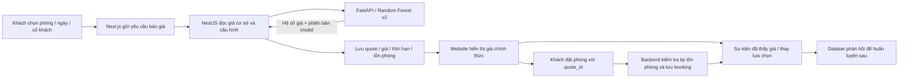

# AI trong HotelAI và bước huấn luyện tiếp theo

Cập nhật: 2026-09-10. Đối chiếu mã nguồn, artifact và metadata hiện có; chưa chạy huấn luyện mới hay thay model đang phục vụ trong lần rà soát này.

AI hiện tham gia trực tiếp vào **báo giá khi khách chọn lịch lưu trú**. Hệ thống đã có đường đi từ website đến model thật và có cơ chế thu phản hồi để huấn luyện tiếp. Phần cần phát triển tiếp là dữ liệu và chất lượng quyết định giá, cùng màn hình quản trị giúp nhìn thấy model đang làm gì.

## 1. Người dùng nhìn thấy AI ở đâu?

| Vị trí | Đang có | Bước tiếp theo đề xuất |
| --- | --- | --- |
| Trang chủ, danh sách và chi tiết phòng | Giá cơ sở từ cơ sở dữ liệu; ảnh và nội dung giới thiệu | Giữ phân biệt giá tham khảo với báo giá theo ngày; nếu thêm lịch so sánh giá, từng giá phải được backend tính thật |
| `/book` và luồng checkout | Chọn phòng, ngày nhận/trả, số khách → báo giá thật; hiển thị nguồn AI/base, giá mỗi đêm, tổng tiền, hạn hiệu lực; lỗi AI có trạng thái lỗi | Giải thích ngắn giá được tính theo lịch lưu trú và số khách, giúp khách đổi ngày và xem lại giá |
| `/admin/pricing` | Bật/tắt AI Pricing, lịch sử hệ số và mức giá đã áp dụng cho booking | Bổ sung khu vực model/version, chất lượng dữ liệu, kết quả đánh giá, tình trạng shadow và lịch sử thay đổi |
| Backend/AI nội bộ | Lưu dấu vết quote, phiên bản model, phản hồi khách; có code conversion và optimizer chạy thử song song | Nối dữ liệu thật và hoàn thiện màn hình quản trị trước khi cân nhắc dùng optimizer quyết định giá khách |

Nguồn: [BookView](E:/hotelAI/4_frontend_nextjs/src/components/features/figma/BookView.tsx), [useReservation](E:/hotelAI/4_frontend_nextjs/src/hooks/useReservation.ts:14), [AdminPricingManager](E:/hotelAI/4_frontend_nextjs/src/components/features/admin/AdminPricingManager.tsx), [API map](E:/hotelAI/docs/agent/API_MAP.md:137).

Chưa có chatbot, gợi ý phòng bằng AI, dự báo công suất phòng bằng AI hay phân phòng bằng AI. Kiểm tra phòng trống và phân phòng hiện dùng quy tắc nghiệp vụ/SQL có khóa chống đặt trùng. Một biểu đồ công suất hiện tại, nếu có, cũng chưa phải dự báo tương lai.

## 2. Một lần báo giá hoạt động thế nào?



Backend tính số ngày đặt trước theo ngày nghiệp vụ của khách sạn. Model nhận chín đặc trưng: số ngày đặt trước; tháng và thứ nhận phòng mã hóa sin/cos; số đêm; số đêm cuối tuần; tỷ lệ đêm cuối tuần; số khách. Loại phòng quyết định giá cơ sở trong database. Random Forest v2 hiện **chưa nhận** tồn phòng, công suất, giá đối thủ, lễ/sự kiện hoặc số yêu cầu đặc biệt làm đầu vào.

Nguồn: [feature contract 2.0.0](E:/hotelAI/2_ai_pricing_service/app/core/feature_contract.py:7), [tính giá trong NestJS](E:/hotelAI/3_backend_core/src/modules/pricing/pricing.service.ts:249).

```text
Giá mỗi đêm = giá cơ sở của loại phòng × hệ số AI
Tổng tiền = giá mỗi đêm × số đêm
```

Ví dụ minh họa công thức: giá cơ sở 1.200.000 VND, hệ số giả định 1,10, ở hai đêm → 1.320.000 VND/đêm, tổng 2.640.000 VND. Đây là ví dụ tính toán, không phải báo giá lấy từ model. Hiện một hệ số áp dụng cho toàn kỳ ở; chưa tính một mức giá riêng cho từng đêm.

Hệ số đầu ra được giới hạn 0,5–3,0. Backend lưu giá và nguồn model bất biến trong quote, mặc định bảo đảm giá 15 phút nhưng chưa giữ phòng. Booking gửi lại đúng `quote_id` để dùng giá đó. Khi tắt AI, quote mới dùng hệ số 1 và nguồn `base`; khi AI đang bật nhưng lỗi, backend trả lỗi thay vì giả lập giá AI. Quote hợp lệ đã lưu vẫn có thể dùng theo điều kiện booking. [Inference](E:/hotelAI/2_ai_pricing_service/app/services/inference.py:107), [quy tắc quote](E:/hotelAI/docs/agent/API_MAP.md:98).

Website đang **chạy dự đoán**, chưa tự học sau mỗi lần khách bấm. FastAPI tải artifact khi khởi động. Muốn học thêm cần xuất dữ liệu → huấn luyện offline → đánh giá → nạp phiên bản được chọn theo quy trình triển khai. Bật công tắc AI trong admin không khởi động một lần huấn luyện. [Khởi động model](E:/hotelAI/2_ai_pricing_service/app/main.py:23).

## 3. Model đã học gì, và mạnh đến đâu?

Artifact hiện có là `random_forest_v2`, training run `dc2e163f5cd9b29d`, tạo ngày 2026-09-04. Model học **mức giá lịch sử tương đối**: ADR (giá phòng bình quân mỗi đêm) chia median ADR của loại phòng, median chỉ được tính từ tập train. Đây là nhãn suy ra từ giá quan sát; script không tạo nhãn giá ngẫu nhiên hay nhãn “giá tối ưu”. [Định nghĩa target](E:/hotelAI/2_ai_pricing_service/notebooks/train_model.py:293).

File nguồn `hotel_bookings.csv` có 119.390 dòng, cấu trúc và khoảng thời gian phù hợp bộ Hotel Booking Demand. Bài công bố gốc mô tả dữ liệu đặt phòng thật của hai khách sạn tại Bồ Đào Nha, giai đoạn 2015–2017. Script đang lấy các booking City Hotel không hủy, ADR dương và ngữ cảnh lưu trú hợp lệ. Hash SHA-256 của CSV hiện tại đã đối chiếu khớp metadata: `7c2ae42a7353905ea136e5c2287f17c92c5435826598bfbb8491c6f0c7b1fc06`. [Bài công bố dữ liệu](https://www.sciencedirect.com/science/article/pii/S2352340918315191), [lọc dữ liệu](E:/hotelAI/2_ai_pricing_service/notebooks/train_model.py:97).

| Kết quả được lưu trong artifact | Giá trị |
| --- | --- |
| Tập train | 36.090 dòng, ngày đến 2015-07-01 → 2017-04-24 |
| Tập kiểm tra tương lai | 9.029 dòng, ngày đến 2017-04-25 → 2017-08-31 |
| Sai số tuyệt đối trung bình ADR (MAE) | 26,565 theo đơn vị ADR của dữ liệu nguồn; không phải VND |
| MAE của quy tắc so sánh theo mùa/thứ | 27,803 |
| Mức giảm MAE so với quy tắc so sánh | 4,45% |
| R² khi đánh giá ADR | 0,303 |
| R² khi đánh giá riêng hệ số giá | -0,323 |

Nguồn: [metadata đã lưu](E:/hotelAI/2_ai_pricing_service/app/models/random_forest_v2.metadata.json:13). Đây là kết quả lần train đã lưu, không phải benchmark mới trong lần sửa UI.

Model đã vượt baseline theo tiêu chí ADR MAE của project, nhưng các số này chưa chứng minh tăng doanh thu tại khách sạn đang xây. Dữ liệu chỉ có booking đã phát sinh, còn pipeline champion lọc tiếp booking không hủy; vì vậy nó chưa học đầy đủ khách thấy giá rồi bỏ đi. Dữ liệu từ thị trường/thời kỳ khác và cách đặt giá cơ sở cũng cần được đánh giá lại với dữ liệu khách sạn của mình. Việc API trả đúng JSON hoặc các test tích hợp đạt không chứng minh model chọn giá tốt.

## 4. Nên huấn luyện bài toán nào tiếp theo?

Ưu tiên tiếp theo phù hợp với code hiện có là **ước lượng xác suất khách chấp nhận báo giá**, song song với việc hiệu chỉnh mô hình giá lịch sử trên dữ liệu đúng khách sạn. Từ đó mới có bằng chứng để phát triển quyết định giá.

| Bước | Câu hỏi model trả lời | Trạng thái |
| --- | --- | --- |
| Giá lịch sử — champion | Lịch ở này thường đi với hệ số giá nào? | Có model phục vụ |
| Chấp nhận báo giá — conversion challenger | Với ngữ cảnh và giá đang chào, khách có tạo booking không? | Có pipeline Logistic Regression và API; chưa có artifact conversion trong thư mục model hiện tại |
| Tối ưu giá — shadow optimizer | Trong các mức giá thử, mức nào có điểm `giá/đêm × xác suất chấp nhận` cao hơn? | Có code và giới hạn mức giá; chỉ chạy shadow khi được cấu hình, chưa thay giá khách |
| Dự báo công suất | Theo từng ngày tương lai, dự kiến bán được bao nhiêu phòng? | Chưa có pipeline/API; cần bài toán và dataset riêng |

Conversion hiện định nghĩa “thành công” là đã tạo booking, kể cả booking `Pending`. Đây chưa phải nhãn đã thanh toán hay đã hoàn thành lưu trú. View đã có thêm nhãn hủy, hoàn thành và tiền thực thu; cần chọn đúng mục tiêu nếu bước sau muốn tối ưu doanh thu thực thu. [Nhãn nghiệp vụ](E:/hotelAI/1_infrastructure/postgres/migrations/015_booking_workflow.sql:685), [conversion pipeline](E:/hotelAI/2_ai_pricing_service/app/training/conversion_training.py:282), [điểm optimizer](E:/hotelAI/2_ai_pricing_service/app/services/shadow_optimizer.py:126).

Đổi giá trong dữ liệu quan sát và thấy xác suất dự đoán thay đổi chưa chứng minh tác động của giá. Ví dụ giá cao có thể cùng xuất hiện với mùa cao điểm; model có thể học mối liên hệ đó. Code đã ghi rõ hạn chế này. Trước khi optimizer quyết định giá thật cần thiết kế thử nghiệm hoặc phương pháp ước lượng tác động phù hợp và giới hạn nghiệp vụ rõ ràng. [Cảnh báo trong contract](E:/hotelAI/2_ai_pricing_service/app/core/conversion_feature_contract.py:31); tài liệu học thêm: [EconML — nhập môn suy luận nhân quả](https://www.pywhy.org/EconML/spec/causal_intro.html).

## 5. Dữ liệu cần thu và việc còn thiếu trước lần train mới

| Nhóm dữ liệu | Đã có trong hệ thống | Việc cần làm tiếp |
| --- | --- | --- |
| Ngữ cảnh lúc báo giá | Phòng, sức chứa, ngày đến/đi, khách, lead time, snapshot phòng bán được/phòng trống, giá cơ sở và giá chào | Kiểm tra độ đầy đủ, ý nghĩa và tính nhất quán theo từng loại phòng/ngày |
| Phản hồi | Quote generated/exposed/rejected/accepted và các kết quả booking | Chỉ dùng exposure đã xác nhận; không xem lỗi mạng hay quote còn mở là khách từ chối |
| Tiền và lưu trú | Thanh toán, hoàn tiền, hủy, hết hạn booking, no-show, hoàn thành có sự kiện xác minh | Phân biệt booking, booking trả tiền và doanh thu thực thu; quyết định nhãn chính cho thí nghiệm |
| Nguồn dữ liệu | Có cơ sở dữ liệu chạy thử riêng | Loại toàn bộ test/demo/bot; không trộn các record smoke test vào tập học thật |
| Mốc nhãn và nhóm hành trình | View có `acceptance_label_available_at`, `exposure_session_id`, `exposure_search_id` | Exporter hiện chưa xuất các trường này; bổ sung để backtest chỉ học nhãn đã biết tại cutoff và kiểm soát nhiều quote thuộc cùng lần tìm kiếm |
| Yếu tố thị trường | Champion chưa dùng lễ/sự kiện/đối thủ | Chỉ thêm khi có nguồn đáng tin và biết được tại thời điểm báo giá; phiên bản hóa contract cùng backend/AI nếu dùng khi serving |

Exporter hiện đọc snapshot nhất quán của view `pricing_quote_training_dataset_v1`, xuất các cột phục vụ model và không xuất tên/email/số điện thoại. Nó chưa thay thế việc kiểm tra nguồn dữ liệu thật hay xử lý các thiếu sót nêu trên. [Exporter](E:/hotelAI/3_backend_core/scripts/export-conversion-training-data.mjs:17).

Các ngưỡng dữ liệu mặc định đã có: **2.000 exposure hợp lệ đã có nhãn, 200 chấp nhận, 200 không chấp nhận, 28 ngày exposure riêng biệt**; cả tập train và holdout phải có hai lớp. Quote chưa hết thời gian quan sát giữ nhãn `NULL`. Nếu thiếu dữ liệu, pipeline xuất `insufficient_data` và không tạo/ghi đè artifact. Đây là ngưỡng khởi đầu của project, chưa phải bảo đảm đủ dữ liệu cho mọi mùa, loại phòng hoặc thí nghiệm doanh thu. [Readiness thresholds](E:/hotelAI/2_ai_pricing_service/app/training/conversion_training.py:69).

## 6. Kế hoạch thực hiện sau bước UI

1. **Chốt mục tiêu đo được.** Chọn bài toán đầu tiên: xác suất chấp nhận quote; theo dõi thêm tỷ lệ trả tiền, hủy/no-show và doanh thu thực thu. Tách chỉ số dự đoán offline khỏi kết quả kinh doanh.
2. **Audit dữ liệu thật và hoàn thiện export.** Xác định database/nguồn dữ liệu, đếm exposure đã có nhãn theo ngày/loại phòng, tách test, bổ sung thời điểm nhãn sẵn có và nhóm tìm kiếm. Giữ một snapshot có hash, mốc thời gian, từ điển dữ liệu và báo cáo loại bỏ dòng.
3. **Tạo baseline và chia tập theo thời gian.** Dùng dữ liệu quá khứ để dự đoán giai đoạn sau; thêm các cửa sổ backtest. Không fit chuẩn hóa/chọn đặc trưng bằng dữ liệu holdout. Đây cũng là nguyên tắc của [scikit-learn về leakage](https://scikit-learn.org/stable/common_pitfalls.html) và [đánh giá dữ liệu theo thời gian](https://scikit-learn.org/stable/modules/cross_validation.html#time-series-split).
4. **Train challenger vào artifact riêng.** Dùng pipeline đang có, so sánh với baseline và champion trên cùng tập. Không ghi đè `random_forest_v2.pkl` trong lúc thử nghiệm. Script hiện có: [train_model.py](E:/hotelAI/2_ai_pricing_service/notebooks/train_model.py:540), [train_conversion_model.py](E:/hotelAI/2_ai_pricing_service/notebooks/train_conversion_model.py:20).
5. **Đánh giá chất lượng trước shadow.** Conversion hiện yêu cầu log loss và Brier score đều tốt hơn constant-rate baseline; báo cáo ROC-AUC, PR-AUC, calibration và từng nhóm phòng/giá. Cần đọc cả đường calibration: Brier thấp hơn một mình chưa bảo đảm xác suất hiệu chỉnh tốt hơn. [Model gate](E:/hotelAI/2_ai_pricing_service/app/training/conversion_training.py:398), [scikit-learn về calibration](https://scikit-learn.org/stable/modules/calibration.html).
6. **Chạy shadow và hiển thị báo cáo quản trị.** Khách vẫn nhận giá champion; lưu dự đoán challenger, latency, lỗi, mức giá đề xuất và kết quả thực tế. Policy khởi đầu yêu cầu tối thiểu 14 ngày shadow, coverage 99%, tỷ lệ lỗi tối đa 1% cùng các gate lineage/dữ liệu. Chưa có endpoint tự promote. [Policy](E:/hotelAI/1_infrastructure/postgres/migrations/013_ai_shadow_guardrails.sql:10), [quy trình hiện có](E:/hotelAI/docs/ai-004-005-execution.md:99).
7. **Đánh giá thử nghiệm giá rồi mới dùng optimizer.** Định nghĩa giá sàn/trần, mức thay đổi cho phép, nhóm/thời gian thử nghiệm, tiêu chí dừng và rollback. Giữ nguyên giá của quote/booking đã cam kết. Việc này là giai đoạn tiếp theo, chưa được triển khai bởi lần sửa UI hiện tại.

Hiện không cần train lại chỉ vì giao diện thay đổi. Phần nối Next → Nest → FastAPI vẫn dùng chung contract, nên có thể cải thiện model và triển khai phiên bản mới mà không làm lại toàn bộ website. Khi thêm feature/API mới thì cần cập nhật contract và kiểm thử xuyên các lớp.

## 7. Kiến thức nên học theo thứ tự

| Chủ đề | Áp dụng trực tiếp vào HotelAI |
| --- | --- |
| Nghiệp vụ doanh thu khách sạn | ADR, công suất, doanh thu/phòng có thể bán, giá cơ sở, giá theo mùa, tiền cọc, hủy/no-show; xác định đang tối ưu điều gì |
| Python, pandas và SQL | Kiểm tra CSV/view, join quote với outcome, thống kê missing/duplicate, tạo snapshot và nhãn đúng |
| Machine learning với scikit-learn | Regression so với classification, Random Forest, Logistic Regression, baseline, MAE/RMSE, log loss/Brier/AUC |
| Đánh giá theo thời gian | Data leakage, nhãn xuất hiện muộn, nhiều quote cùng hành trình, train/validation/test, backtest và calibration |
| Thử nghiệm và quan hệ nhân quả | Hiểu khác biệt giữa dự đoán khách nào đặt phòng và tác động khi thay giá; thiết kế phép thử có thể đo được |
| Triển khai và theo dõi model | Feature contract, artifact/hash/version, FastAPI, test tính nhất quán train/serve, shadow, drift, giám sát và rollback |

Có thể học trên chính các file được dẫn ở trên: đọc một quote từ UI đến bảng dữ liệu, tái tạo vector chín feature, giải thích một kết quả giá, rồi dựng một báo cáo đánh giá nhỏ. Hoàn thành vòng này sẽ hữu ích cho bước train tiếp theo hơn việc chuyển ngay sang model lớn hơn.
